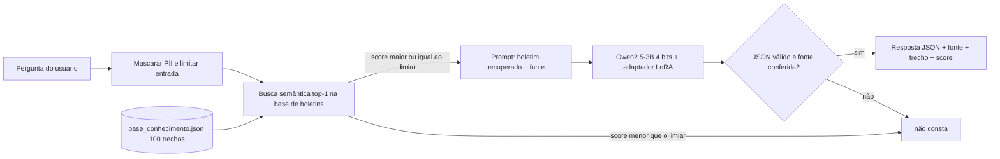
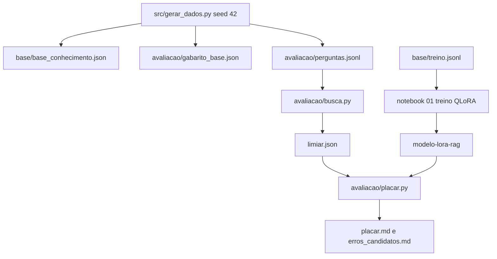
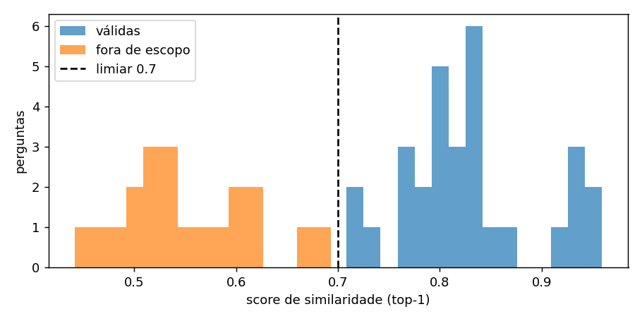

# Relatório — LLM local para consulta de boletins de ocorrência

## 1. Ficha técnica

| Item | Descrição |
|---|---|
| Problema | **Segurança pública.** Atendentes e cidadãos precisam consultar boletins de ocorrência escritos em linguagem informal (gírias, frases soltas) e obter dados estruturados com a origem da informação, sem inventar fatos |
| O que a IA faz | Recebe uma pergunta, busca o boletim mais relevante e devolve um JSON com `local`, `crime`, `arma`, `tipo_arma`, `estado_vitima` e `fonte`. Se não houver boletim relevante, responde `{"resultado": "não consta"}` |
| Modelo | Qwen2.5-3B-Instruct em 4 bits (NF4), rodando localmente (RTX 4060, 8 GB) |
| Especialização | QLoRA (r=16, alpha=32, q/k/v/o, 7,4 M parâmetros treináveis = 0,24 %), 200 exemplos, 3 épocas |
| Busca | Embeddings (sentence-transformers) com limiar de similaridade calibrado |
| Tarefa e gabarito | 30 perguntas válidas (gabarito = boletim e campos) + 20 fora de escopo (gabarito = "não consta") + 30 casos de extração isolada (4 "não consta") |
| Hipótese testada | O pipeline especializado acerta mais e alucina menos que o modelo sem contexto |
| Segurança / LGPD | Ver README: pergunta fora do prompt, saída validada por schema, PII mascarada, base sintética, processamento local |

## 2. Diagrama do pipeline

Documentos do projeto:

## 3. Base de dados

| Fonte | Formato | Licença | Nº de trechos |
|---|---|---|---|
| Boletins de ocorrência sintéticos (`src/gerar_dados.py`, seed 42) | JSON (`id_bo`, `texto`, `fonte`, `formato`, `licenca`) | MIT, dados sintéticos criados pelo projeto, sem dados pessoais | 100 |
| Exemplos de ajuste do LoRA (`base/treino.jsonl`) | JSONL (`tarefa`, `codigo`, `tipo`) | MIT, sintético | 200 (36 de recusa) |
| Casos de extração com gabarito (`avaliacao/teste_extracao.jsonl`) | JSONL | MIT, sintético | 30 (4 de recusa) |
| Perguntas de avaliação (`avaliacao/perguntas.jsonl`) | JSONL (`pergunta`, `categoria`, `gold_ids`) | MIT, sintético | 50 (30 válidas + 20 fora de escopo) |

## 4. Performance das configurações testadas 
## Busca semântica — recall e limiar

Base: 100 trechos | 30 perguntas válidas (com gabarito) + 20 fora de escopo (devem virar "não consta")

| Buscador | recall@1 | recall@3 | limiar escolhido | acurácia da decisão no limiar |
|---|---|---|---|---|
| all-MiniLM-L6-v2 | 90% | 100% | 0.7 | 94% |
| paraphrase-multilingual-MiniLM-L12-v2 | 73% | 93% | 0.67 | 82% |

**Escolhido:** `sentence-transformers/all-MiniLM-L6-v2` com limiar **0.7**.

### Justificativa do limiar

Decisão correta = (pergunta válida com score >= limiar **e** top-1 certo) ou (pergunta fora de escopo com score < limiar).

| limiar | 0.4 | 0.5 | 0.6 | 0.65 | 0.7 | 0.75 | 0.8 | 0.85 |
|---|---|---|---|---|---|---|---|---|
| acurácia | 54% | 64% | 84% | 90% | 94% | 88% | 78% | 54% |

Scores das perguntas válidas: min 0.71, mediana 0.82. Fora de escopo: mediana 0.54, máx 0.69. A acurácia máxima (94 %) ocorre somente em 0.70. A margem é estreita: o menor score de pergunta válida (0.71) e o maior de pergunta fora de escopo (0.69) distam 0.02, e o limiar 0.70 fica exatamente no meio. Com uma base maior ou perguntas mais variadas, o limiar deve ser recalibrado.

## Placar das três configurações

Buscador `all-MiniLM-L6-v2`, limiar 0.7, geração greedy (determinística). 30 perguntas válidas + 20 fora de escopo.

### Ponta a ponta (pergunta → busca → geração)

| Métrica | A · Base sem contexto | B · Base + RAG simples | C · LoRA + RAG |
|---|---|---|---|
| Acerto total (resposta certa ou recusa certa) | 16/50 (32%) | 34/50 (68%) | 45/50 (90%) |
| JSON válido (schema) | 19/50 (38%) | 46/50 (92%) | 50/50 (100%) |
| Fonte correta (válidas) | 0/30 (0%) | 27/30 (90%) | 27/30 (90%) |
| Campos + fonte corretos (válidas) | 0/30 (0%) | 14/30 (47%) | 25/30 (83%) |
| Recusa correta (fora de escopo) | 16/20 (80%) | 20/20 (100%) | 20/20 (100%) |
| Alucinação (menor é melhor) | 31/50 (62%) | 14/50 (28%) | 3/50 (6%) |

### Extração isolada (30 casos com gabarito, 4 são "não consta")

| Métrica | B · Base + RAG simples | C · LoRA + RAG |
|---|---|---|
| Acerto total | 11/30 (37%) | 23/30 (77%) |
| Vocabulário conhecido | 5/15 (33%) | 13/15 (87%) |
| Vocabulário inédito | 6/15 (40%) | 10/15 (67%) |
| Recusas ("não consta") | 4/4 (100%) | 4/4 (100%) |
| JSON válido | 29/30 (97%) | 29/30 (97%) |

Configurações: **A** base sem contexto · **B** base + RAG simples (schema e exemplo no prompt) · **C** LoRA + RAG.

**Interpretação**

- **Efeito do contexto (A → B).** O acerto total sobe de 32 % para 68 % e a alucinação cai de 62 % para 28 %. Sem contexto, o modelo não consegue citar um boletim real (fonte correta 0/30) e só 38 % das respostas seguem o schema JSON. É a evidência de que o RAG reduz a alucinação.
- **Efeito da especialização (B → C), com o mesmo contexto e o mesmo buscador.** O acerto total vai de 68 % para 90 %, campos e fonte corretos de 47 % para 83 %, JSON válido de 92 % para 100 % e a alucinação de 28 % para 6 %. A fonte correta é igual nas duas (90 %) porque depende só da busca (recall@1 de 90 %, 3 perguntas erradas). Logo, o ganho do LoRA está na extração dos campos, não na citação da fonte.
- **Recusa.** B e C recusam 20/20 das perguntas fora de escopo, contra 16/20 em A. Esse resultado vem em grande parte do limiar da busca, que filtra antes do LLM; não deve ser atribuído ao LoRA.
- **Generalização.** Na extração isolada o LoRA passa de 37 % para 77 %, mas cai de 87 % (vocabulário conhecido) para 67 % (inédito). O adaptador memoriza parte do vocabulário de treino. Mesmo assim supera o RAG simples nos termos inéditos (67 % contra 40 %).
- **Limitações.** Base sintética e pequena, vocabulário controlado e 50 perguntas (intervalo de confiança largo). O limiar tem margem de apenas 0.02 entre os scores válidos e os fora de escopo.

## 5. 5 erros reais, causa e correção

Os erros abaixo vieram das saídas salvas em `notebooks/01_treinamento_lora.ipynb`. As correções dos erros 1, 2, 4 e 5 já estão
aplicadas em `src/comum.py` e `avaliacao/`, e o placar final do notebook 02 usa a versão corrigida. A correção do erro 3
(rebalancear o treino) permanece como **proposta**: o adaptador não foi retreinado.

| # | Erro observado | Causa | Correção proposta |
|---|---|---|---|
| 1 | O LoRA falhou nas **4 de 4 recusas** do teste de extração, respondendo `{"localizacao": "não consta", "texto": "nenhum documento relevante encontrado"}` no lugar de `{"resultado": "não consta"}` | O system prompt da avaliação (`... Responda APENAS com o JSON.`) era diferente do usado no treino (`Você é um extrator de entidades JSON.`). Com o prompt do treino, o LoRA recusou corretamente as perguntas fora de escopo | Prompt único em `src/comum.py` (`SYS_LORA`), usado em treino, avaliação e API |
| 2 | O modelo base acertou só 4/30 na extração: **21 respostas sem as chaves do schema** (muitas vezes `{"resultado": "não consta", "fonte": ...}` mesmo com contexto válido) e **5 JSONs quebrados** | O prompt não informava as 6 chaves nem o formato dos valores. Além disso, o regex `\{.*?\}` cortava JSON aninhado | RAG simples com schema e exemplo no prompt (comparação justa com o LoRA) e parser `raw_decode` + validação por schema (pydantic) |
| 3 | O LoRA errou `arma`/`tipo_arma` quando a arma era desconhecida (6 de 8 erros de extração não relacionados à recusa): `arma: true/false` no lugar de `null` | Só 9 dos 164 exemplos de treino com boletim (5 %) tinham arma "desconhecido", e as frases-padrão geravam texto sem sentido ("O bandido tava com estava escuro") | Rebalancear o treino (pelo menos 20 % de "desconhecido"), corrigir os templates e aplicar regra de pós-processamento (`tipo_arma = desconhecido` ⇒ `arma = null`) |
| 4 | Perguntas **válidas** ("homicídio na praça da sé", score 0,67; "agressão na avenida paulista", score 0,66) foram descartadas pelo limiar 0,75, e o gabarito do placar mudou para "não consta" automaticamente | Limiar escolhido sem calibração, e gabarito dependente do próprio limiar (avaliação circular) | `avaliacao/busca.py` calibra o limiar com perguntas válidas e fora de escopo; o gabarito agora vem da categoria da pergunta |
| 5 | Para "assalto com revólver no estacionamento do shopping" a busca devolveu um boletim de **homicídio** (BO-7755) e o modelo extraiu `crime: "homicídio"` | A base antiga era aleatória e podia não ter um boletim equivalente; a busca era top-1 sem gabarito nem recall medido, e a base tinha ID duplicado (BO-7021). Testamos a hipótese de que o `all-MiniLM-L6-v2` (inglês) era o problema: o buscador multilíngue teve recall@1 **pior** (73 % contra 90 %), então a hipótese foi refutada | Medir o recall contra `gold_ids` e escolher o buscador pelos dados (`all-MiniLM-L6-v2`: recall@1 90 %, recall@3 100 %), IDs únicos e gabarito por boletim. Próximo passo: como o recall@3 é 100 %, reordenar (reranking) os 3 melhores resolveria as 3 perguntas erradas no top-1 |

Observação adicional: sem contexto (config. A), o modelo inventa campos e fontes como `"fonte": "contexto_recuperado"`;
é exatamente a alucinação que o RAG elimina.

## 6. Conclusão técnica

O pipeline cumpriu a hipótese: a configuração C (LoRA + RAG) acertou 90 % das 50 perguntas, contra 68 % do RAG simples e 32 % do modelo sem contexto, e reduziu a alucinação de 62 % (A) para 28 % (B) e 6 % (C). O contexto recuperado trouxe a citação de fonte (0 % para 90 %) e eliminou a maior parte da invenção de fatos; o LoRA, com o mesmo contexto, elevou os campos corretos de 47 % para 83 % e levou o JSON válido a 100 %. O que ainda falha: três perguntas em que a busca traz o boletim errado no top-1 (recall@1 de 90 %), erros de `arma`/`tipo_arma` quando a arma é desconhecida (erro 3, não retreinado) e a queda de generalização em vocabulário inédito (87 % para 67 %). Como o recall@3 é 100 %, o próximo passo mais barato é reordenar os 3 melhores resultados da busca e, depois, rebalancear o treino com mais exemplos de arma desconhecida. A conclusão vale para uma base sintética e pequena e não foi validada com boletins reais, nos quais a linguagem é bem mais variada.

